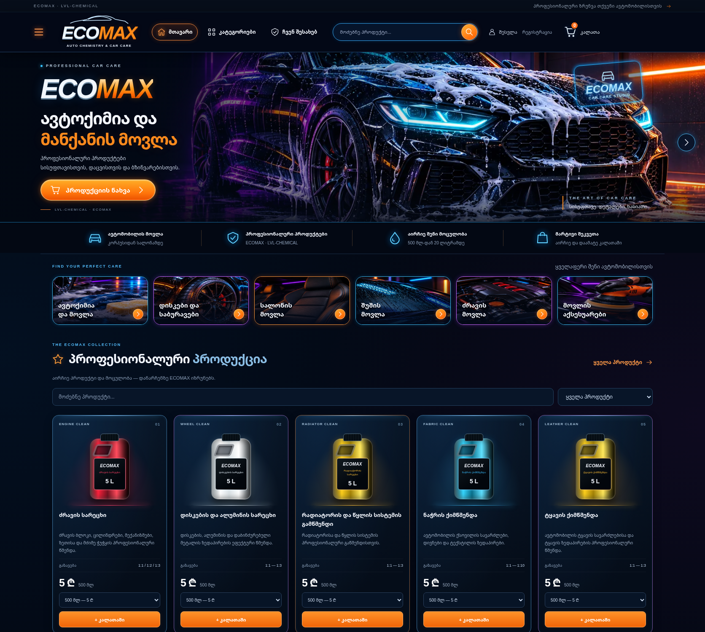

# ECOMAX — NEON 3D MAX PREMIUM

A responsive HTML/CSS/JavaScript redesign based on the supplied neon storefront reference. The reference guides composition, blue/orange/violet lighting, navigation, category tiles, glass surfaces and product presentation. It is not embedded as a full-page image.

## Preview

[Desktop preview](preview/desktop.png) · [Mobile preview](preview/mobile.png)



The hero and category illustrations are decorative generated automotive artwork. The catalogue keeps its original CSS packaging illustrations; no new product photography, prices, discounts, ratings or specifications were invented. The repository's existing product-showcase WebP fails decoding, so the redesign does not depend on it.

## Run locally

From the repository root:

```sh
python3 -m http.server 8000 --bind 0.0.0.0
```

No package installation or production build is required for the static storefront. The separate Android applications are outside this web redesign.

The cloud environment already provides Python 3.12, Node 24, Python Playwright 1.62 and `/usr/bin/chromium`. With the server running, execute:

```sh
python3 tests/neon-smoke.py
node --check js/neon-premium.js
git diff --check
```

The final Chromium run passed **17/17 checks**. [Results](preview/smoke-results.json). Node syntax validation and `git diff --check` also passed.

The smoke runner exits nonzero on failure and writes screenshots plus `smoke-results.json` to `/tmp/ecomax-preview`. It checks the original 31-product fixture, prices/options/descriptions, four viewport widths, search/filtering, header/category controls, cart quantity/price/persistence/removal, keyboard focus, mobile menu, anonymous checkout gate, and local login/register/checkout forms. It does not register users, sign in, submit orders or write to the backend.

## Preserved integrations

- Existing Supabase client, project settings, keys, session logic and authentication scripts.
- Existing product names, descriptions, dilution information, prices and volume options.
- Existing cart storage, add/remove/quantity functions and checkout/order logic.
- Existing account, registration, courier and administrative routes through navigation.

Accumulated homepage inline presentation overrides and the unused polling search layer were replaced by `css/neon-premium.css`, `css/product-art.css` and `js/neon-premium.js`. The shared account stylesheet changes only presentation on login, registration and checkout pages.

## Validation limitations

Local anonymous workflows are tested. Live authentication and order submission are not tested and no production data was modified. Google Fonts, the existing Supabase host and GitHub's PR API are blocked by the current cloud network policy until the saved environment settings are applied. System font fallbacks remain usable. Required additions: `fonts.googleapis.com`, `fonts.gstatic.com`, `mkxkqdvtmfbxmldnvsef.supabase.co`, `api.github.com`. The existing jsDelivr dependency remains allowed.

Screenshots are local captures, not evidence of a public deployment. Main is preserved; merge only after owner review.
